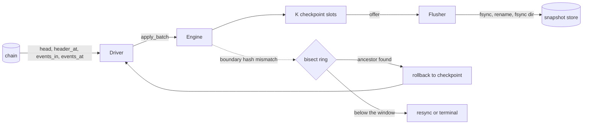

# chainfold

A sans-io fold engine for ordered chain events, with fork recovery and durable snapshots.

<!-- ANCHOR: intro -->
chainfold folds ordered chain events into consumer state: engine-enforced total
order over (block, log_index), fork detection by ancestry commitment, bounded
rollback to retained checkpoints, and a durable snapshot envelope.

### how it works

A relayer or wallet polls logs from one chain and folds them into local state. The chain
reorgs, the node lags, the process restarts. Every consumer rewrites that loop, and the
loop is where the bugs live: skip-and-diverge on a failed event, a cursor that is not
durable, a reorg noticed only when a proof stops verifying.

- **apply**: a poll fills one `Batch`; the `Engine` enforces the total order, drops
  everything at or below the cursor as already applied, and counts the events the fold
  declares are not its own.
- **poll**: the driver keeps the last head a scan covered, the tip. A poll whose head is
  the tip makes one call; a head one block on top of it makes two, the head and that
  block's logs by its hash. Only a gap reads more.
- **detect**: each batch carries the current header of the cursor block, from the first
  window's answer, which starts at that block, or from the tip, which commits to it. A
  block hash commits to its whole ancestry, so a reorg touching anything at or below the
  cursor changes that one hash. One 40-byte compare per poll.
- **recover**: on a mismatch, the driver bisects the ring of observed blocks with
  `header_at` for the deepest still-canonical block, rolls back to the newest checkpoint
  at or below it, and refolds forward. `O(log W)` probes, then deterministic replay.
- **persist**: the driver offers the oldest retained checkpoint to a sink; a flusher
  thread fsyncs it. The durable cursor trails the applied cursor and names what a
  restart recovers, so the apply path never fsyncs and replay closes the gap.



Fold state is fully generic; the crate pins no provider, no runtime, and no storage
engine in its core.
<!-- ANCHOR_END: intro -->

## design

<!-- ANCHOR: design -->
Three layers, each usable without the one above it: the `Engine` (`no_std` + `alloc`,
sans-io, single writer), the `Driver` (sans-runtime, owning cadence, backoff, scanning,
and recovery), and the adapters (`std`: tokio harness, snapshot store, flusher).

- `Position` is `(block, log_index)`. `log_index` is block-unique on EVM, so a tx index
  would be redundant and invite inconsistent adapters.
- dedup is positional only. The cursor is the sole mechanism; there is no seen-set to
  grow without bound.
- `FoldError` is classified at the fold, not guessed by the engine: `Skip` (not mine,
  counted and stepped over), `Halt` (clean below this position, rollback or resync),
  `Poison` (partially mutated, untrusted until a restore). A panic out of `apply` that
  the caller catches leaves the engine `Poisoned` too, so no event is folded twice.
- `Source` is four reads: `head` (the head block and its parent's hash), `header_at`,
  `events_in` (a range of heights), and `events_at` (one block, by hash). The driver
  owns the window walk, the boundary read, and the grouping into spans, so a source
  cannot get the batch shape wrong and every source gets fork detection. Every walk
  reads the head block again after the events and drops the batch when it moved, so a
  reorg that lands between two windows, or inside one answer, is retried, not folded.
  Two hashes at one height are a source error. `Ok(None)` from a probe means suspected
  fork.
- rollback is bounded to K retained checkpoints. Over-rollback past still-canonical but
  unobserved blocks is intended; the discarded events replay deterministically.
- the recovery ladder is rollback, then resync from genesis, then a typed terminal state.
  A fork deeper than the window or below every checkpoint resyncs; the only terminal
  `DivergenceCause` is a source horizon short of the start block.
- `Halt` and `Poison` stop the driver at `Tick::Terminal`: the fold is deterministic, so
  replaying into the same event would stop again. The caller recovers through
  `engine_mut`, with `rollback_at_or_below` or `reset`.
- `EngineStatus::Unrecoverable` is only left by a `reset`. Automated progress stops
  rather than folding on untrusted state.
- the snapshot envelope is engine-owned: magic, format version, fold identity tag,
  cursor, observed ring, state bytes, CRC32C trailer. The ring travels inside it, so a
  restarted engine detects a reorg that happened while it was down.
- lengths decoded from stored bytes are bounded before any allocation and every offset is
  checked, so a corrupt length prefix is a typed error rather than an OOM primitive.
- the durable cursor rides the manifest as a watermark. Commit writes a temp file, fsyncs
  it, renames, then fsyncs the directory; the manifest is dual-slot, and a commit
  overwrites the older slot so a torn write only damages the copy already superseded.
- the watermark names the snapshot the manifest points at, and counts only offers made
  since the last engine reset. A resync resets the sink, so the watermark drops to none
  at once and rises again only when a snapshot of the new chain commits; a job queued
  before the reset still reaches disk but never raises it. Reporting the old height would
  promise a durable point on a chain that no longer exists. `SnapshotStore::durable_cursor`
  still names what a reopen recovers, which may be the pre-reset snapshot; restarting from
  it is safe, because the ring inside it detects the reorg.
- the observed ring is structure-of-arrays with power-of-two capacity, so bisection binary
  searches the number lane alone and touches one hash at the end. W = 1024 is 40 KiB.
- `Batch` is flat: one contiguous event array plus a span array indexing into it. Two
  allocations per poll, both pooled and reused by the driver.
- the apply path allocates zero. That is a CI assertion under a counting allocator, not a
  convention.
- one engine per chain. Coordinated cross-chain rollback is an explicit non-goal;
  consumers join across chains themselves.
<!-- ANCHOR_END: design -->

## usage

<!-- ANCHOR: usage -->

### fold and engine (`default-features = false`)

```rust,ignore
use chainfold::{Engine, EngineConfig, Fold, FoldError, Position};

#[derive(Clone, Default)]
struct Balances { total: u128 }

impl Fold for Balances {
    type Event = u128;
    type Error = &'static str;

    fn apply(&mut self, _pos: Position, event: &u128) -> Result<(), FoldError<&'static str>> {
        self.total = self.total.checked_add(*event).ok_or(FoldError::Halt("overflow"))?;
        Ok(())
    }
}

let mut engine = Engine::new(Balances::default(), EngineConfig::default())?;

// a batch per poll: ordering, dedup, boundary recheck, fork detection
let summary = engine.apply_batch(&batch)?;
engine.checkpoint();
```

### driver and harness

```rust,ignore
use chainfold::{Driver, DriverConfig, EngineConfig, Tick, harness};

let mut driver = Driver::new(
    Balances::default(),
    source, // your Source
    EngineConfig::default(),
    DriverConfig::from_block(deployment_block),
)?;

// sans-runtime: the whole loop a consumer without tokio writes
loop {
    match driver.tick() {
        Tick::Terminal(_) => break,
        _ => std::thread::sleep(driver.next_delay()),
    }
}

// or, with the tokio feature
let mut handle = harness::spawn(driver);
let status = handle.wait_caught_up().await;
```

A suspected fork bisects to the ancestor and rolls back; only a fork below every retained
checkpoint escalates to a resync. `with_sink` and the `resume*` constructors add a
`SnapshotSink`.

### durability (`storage` feature)

`SnapshotStore::open` returns whatever the last commit made durable, `Engine::decode_snapshot`
rebuilds an engine from it, and `resume` polls onward from the durable cursor. `Flusher` is
the `SnapshotSink` in between: the driver offers, the flusher thread fsyncs, and the
watermark moves onto the committed snapshot only when the fsync returns.

`examples/replay.rs` runs the whole shape end to end: fold to the tip under a live flusher,
survive a reorg, then restart from the durable cursor and converge on the same state.

```sh
cargo run -p chainfold --example replay --features tokio,storage,test-helpers
```

The snapshot directory is trusted input. The checksums (CRC32C) catch corruption, not
tampering. `decode_snapshot` returns a well-formed engine for any bytes (T6), but a file
crafted with a valid checksum can set any cursor and fold state, and it is accepted.

### Features

| feature | pulls in | notes |
|---|---|---|
| (default) | nothing | `no_std` + `alloc` core: engine, driver, traits |
| `std` | crc-fast | runtime-detected SIMD CRC32C, std error plumbing |
| `serde` | serde | derives on `Position` and `BlockRef` |
| `wincode` | wincode, crc | snapshot envelope, `Persist`, `encode_snapshot` / `decode_snapshot` |
| `storage` | `std` + `wincode` | `SnapshotStore`, `Flusher`, `Vfs` |
| `tokio` | tokio | `harness::spawn`, watch-backed status, `wait_caught_up` / `wait_durable` |
| `test-helpers` | nothing | `RecordingFold`, `NoopFold`, `ScriptedChain`, `WatermarkSink`, `CrashVfs` |
| `docs` | include-utils | folds this README into the crate docs |

`default = []`: the core is the part every consumer wants, and the adapters each drag in a
dependency stack that a guest or wasm build has no use for.

### Tuning

- `EngineConfig::ring_capacity` (W): observed-block window, a power of two in `[2, 1 << 20]`.
  It bounds fork detection; a fork deeper than the oldest ring entry resyncs from the
  start block.
- `EngineConfig::checkpoint_slots` (K): retained rollback points, at most `1 << 16`. Zero
  disables rollback, so a resync (`reset`) is the only way out of `Halt` or `Poison`,
  and anchor checks never fire. That is the default shape of most consumers today, not an edge case.
- `DriverConfig::checkpoint_interval`: blocks of cursor progress between automatic
  checkpoints. The reorg an offered snapshot survives without a resync is
  `checkpoint_slots * checkpoint_interval` blocks; size both against the deepest reorg
  your chain produces.
- `DriverConfig::snapshot_interval`: blocks of durable-point progress between sink offers.
  `None` disables offers entirely.
- `DriverConfig::poll_interval`, `backoff_base`, `backoff_max`: cadence at the tip, and
  the capped exponential backoff after a source error. A tick that moved the cursor asks
  for no delay, so catch-up and post-resync replay run at source speed.
- `Flusher::spawn(store, queue_depth)`: snapshot jobs admitted before an offer blocks. The
  bound is the backpressure signal when the disk falls behind.
- `StoreConfig::retain`: superseded snapshot files kept beyond the two the manifest names,
  minimum 1.
- `MAX_ENVELOPE_FIELD_LEN` (1 GiB, compile-time): ceiling on a length-bearing envelope
  field. It caps the allocation a decoded length prefix can drive, and encoding past it is
  `SnapshotError::TooLarge`.
<!-- ANCHOR_END: usage -->

## verification

<!-- ANCHOR: verification -->
### verification

[Verus](https://github.com/verus-lang/verus) proves the core invariants in place, in
attribute mode. The proofs cover the
`no_std + alloc + wincode` build. Normal builds do not need Verus: every annotation
is behind `cfg(verus_keep_ghost)`. The spec model is in `src/verus/model.rs`. The
trusted items are in `src/verus/tcb.rs`.

#### what Verus proves

- **T1, position.** `lt` is a strict total order: irreflexive, transitive, and
  trichotomous. `pos_gt` and `Position::new` match their specs. No proof uses the
  derived `Ord`; the test `position_order_is_block_then_log_index` checks that it
  compares block, then log index.
- **T2, batch.** `validate` returns `Ok` if and only if the batch is well shaped.
  Well shaped means: blocks strictly ascending, no empty span, and log indices
  strictly ascending in each span. `Ok` implies that the flattened positions are strictly ascending. Each `Err`
  names the first violation (`first_descent` gives the least `i >= 1` with
  `v[i] <= v[i-1]`).
- **T3, apply.** `apply_batch` runs the fold on the entries after the cursor, in
  order, up to the first stop. A rejection changes only the checked freshness. The
  fold, cursor, and ring follow those calls. On `Ok`, `skipped` counts the calls that
  returned `Skip`, `skip_count` grows by it (saturating), and nothing of the batch is
  newer than the cursor, so a second apply runs the fold on nothing and keeps the fold
  and cursor (`lemma_idempotent`).
- **T4, ring and bisection.** Every `BlockRing` fn matches its `Seq` model, and
  `Observed::next` yields the head of the iterator's view. `index_at_or_below` finds
  the last entry at or below `n` in at most `floor(log2 len) + 1` loop steps, in its
  ensures (a tracked step count that the build erases).
  `canonical_prefix` makes at most `log2 len + 1` source calls, in its ensures. Its
  result is safe under A1 alone. It is optimal under A1, A2′, and `down_closed(V)`.
- **T5, checkpoint and rollback.** The checkpoint ring keeps its invariants.
  `rollback_at_or_below` picks the newest live slot at or below the target. It
  restores the fold, cursor, and ring prefix of that slot. An `Err` leaves the engine
  unchanged. The refold invariant `inv(init, log)` holds across `checkpoint`,
  `rollback_at_or_below`, `reset`, and `mark_unrecoverable`. `apply_batch` extends
  the log by the entries it ran the fold on.
- **T6, durable cursor and restart.** `durable_point() <= cursor()` in every `wf`
  state. `decode_snapshot` returns only `wf` engines, for any input bytes, with no
  trust in the codec. An `Ok` passed the length, magic, version, and CRC32C checks
  on the input bytes (`frame_checked`). The envelope it decoded carried the fold's own
  tag and an ascending ring within W that ends at the cursor block.
  `encode_durable_snapshot` returns the durable point and appends the durable
  frame: the codec's bytes for the durable snapshot's envelope, then their CRC32C.
  Decoding that frame, under a config whose window holds the ring, gives back the
  durable snapshot view except for the fold (A5), or the fold's `State` error. That
  direction trusts the codec round trip (tcb items 6 and 7). `Driver::status` reports
  `durable_cursor <= cursor` while the driver state is `durable_ok`. Every
  driver method keeps `durable_ok`, except `engine_mut`, which keeps it when the caller
  leaves the engine unchanged or resets it. Its other edits are the caller's to keep in
  line: the engine's own methods do by inspection, but no spec says so.
- **T7, driver end to end.** Under A1, A2, and A3, `Driver::tick` keeps the ghost
  invariant `dinv`. `new` and `with_sink` start a driver in it, and every `Resynced`
  tick restarts it. `resume` and `resume_with_sink` keep it for an engine that is in it
  under the driver's genesis fold and start block. After a tick that returns
  `Progressed` or `Idle` with the engine `Active`, the fold equals the fold of the
  canonical logs, up to the cursor, of one view the tick's calls answered from, and the
  ring is a hash chain in that view. After `RolledBack`, `inv` holds over the canonical
  logs of a view that confirmed the probed ring entry, when that view holds every height
  from `start_block` to that entry. `dinv` also covers the scan tip, as a fact of its
  hash: every view that holds the tip agrees with the chain view of `dinv` up to the
  cursor block, and holds nothing to fold between the cursor and the tip. T7 takes A2
  (iii) and (iv) only for the views of the tick itself, so a tick may answer from a
  view older than one an earlier tick read. The test
  `a_tick_on_an_older_view_folds_what_a_fold_from_scratch_of_it_does` runs such ticks
  and checks each fold against a fold from scratch of the view that the tick read.

  A tick returns `SourceError` only if a source call failed or the chain changed during
  the tick: some call answered from a view other than the first call's. The engine never
  rejects the batch a scan builds, since the batch is shaped and its boundary is at the
  cursor block. This needs no A2. `infallible` names a source whose calls all succeed.

  No proof shows that a decoded snapshot is in `dinv`: that rests on the driver that
  wrote it having been in it, on the state codec (A5), and on the source still holding
  the chain its ring names. So a resumed driver has T7 only as far as its engine is in
  `dinv`, and outright from its first `Resynced` tick on. `engine_mut` clears the tip.
  After an edit through it, T7 covers the driver again from its next `Resynced` tick.

Verus checks every exec fn in the in-scope files for panics and overflow. The only
exceptions are the fns listed as out of scope in `Cargo.toml`.

#### assumptions

- **A1, hash commitment.** A block hash commits to its number, its logs, and its whole
  ancestry. Each view that a source presents satisfies `a1::<S, E>(V)`: `chain(V)`
  plus strictly ascending log indices. The decoded logs are per source type
  (`logs::<S, E>`).
- **A2, source answers.** (i) Each `head`, `header_at`, `events_in`, and `events_at`
  call answers from one view. The source spec records that view in `sview_log`. A node
  that tears one range answer across a reorg breaks this, and a scan drops such an
  answer when the head block moved under it.
  (ii) `events_in` appends every event of its range in that view and no other, in any
  order. `events_at` appends exactly the events of the block with that hash, in any
  order, and errs on a hash the source does not know or has not executed (JSON-RPC:
  `eth_getLogs` with `blockHash`). geth breaks this for a block it holds no receipts for
  (it answers nothing), and erigon before 3.7.0 for a hash off its canonical chain (it
  answers the canonical block at that height). Nothing in the crate checks an answer
  against the block: a dropped or an invented log is folded as given, and nothing
  reports it. A1 then also needs the source to check logs against the receipts root, or
  to trust its node. (iii) No ABA only on the head block within one tick: a view of the
  tick between two views that hold the head block the tick read first holds it too. The
  scan tip needs no such assumption across ticks, because A1 makes it a fact of the tip's
  hash, true in every view that holds the tip. The block on top of the tip is read by
  its hash, so a load-balanced node without it errs and the tip stays below it. Only a
  range read on a backend that clamps it can still break (iii): behind a load balancer
  whose nodes lag each other, a node that answers `events_in` past its own head with
  nothing answers the newest blocks with nothing, the tip moves past them, and their
  events are skipped. Point such a source at one node, at nodes that never answer below
  a head another has reported, or at nodes that err on a range past their own head.
  (iv) Each view holds every height from `start_block` up to each height it holds.
- **A2′, one bisection view.** All probes of one bisection see one view. Only the
  optimality of `canonical_prefix` needs it. Optimality also takes `down_closed(V)` as a hypothesis: `V`
  holds every height below each height it holds. `a1` does not include this, because
  a pruned source answers `None` below its horizon. T7 takes the weaker A2 (iv).
- **A3, fold determinism.** `Fold::apply` is a function of the state view, the
  position, and the event. The state view is `fview(&f)`, an uninterpreted `int`
  (`F: ?Sized`, so `Fold` has no `Sized` bound). A `Halt` keeps the view. `Clone`
  keeps the view (tcb item 1). Edits through `fold_mut` must keep the view. For this
  reason `fold_mut` is out of scope.
- **A4, sink honesty.** `SnapshotSink::durable_cursor` is `None` or a point offered
  since the last `reset` (`sink_offered`). The sink given to a driver has offered
  nothing past the engine's cursor and its live slots. The shipped sinks trusted for
  this are `NoSink` (tcb item 12) and `storage::Flusher`. The flusher's watermark
  changes behind `&self`, from its fsync thread, but only onto a point that `offer`
  queued since the last `reset`. Its `submit` is private, so no other caller can queue
  a point, even through `Driver::sink`.
- **A5, state codec.** `Persist::decode_state` of `encode_state`'s bytes gives back
  the same fold view. Safety does not depend on this, only recovery of the same state.
- **A6, trusted items.** Each item in `src/verus/tcb.rs`, listed below.
- **A7, tooling.** Verus, Z3, vstd's `std_specs`, and rustc codegen are correct.
  Allocation succeeds (partial correctness). vstd's `Vec` specs model neither
  out-of-memory nor the capacity-overflow panic; `EngineConfig::valid` bounds every
  vector `Engine::new` sizes up front (W <= 2^20, K <= 2^16), so that panic would need
  an element type of more than 2^43 bytes. The `std` build differs from the proved
  build only in import paths and the CRC backend.

A source that breaks A1 or A2 has no guarantee, and the faults the driver notices loop
without a signal of their own. A source that repeats every log returns `SourceError` on
every tick, because the batch fails `validate`. One whose `head` hash never matches its
`header_at` for that height returns `SourceError` on every walk.
One whose `header_at` disagrees with the hashes its `events_in` answers carry keeps
falling back to the walk or rolling back and refolding. With K = 0, one `None` from a
lagging node at the cursor block resyncs from the start block.

#### trusted items (`src/verus/tcb.rs`)

1. `axiom_clone_preserves_fview`: a clone has the same fold view (A3).
2. `Vec::into_boxed_slice` keeps the elements in order (std docs).
3. `<[T]>::sort_unstable_by_key` permutes the slice and leaves it in key order (std
   docs): for two elements in order, some keys the key fn may return for them are in
   order. The caller must show that the key fn accepts every element and that the key's
   `Ord` is a total order (`obeys_cmp`). `group_into` uses it.
4. `snapshot::crc32c`: the checksum is a function of the bytes (`crc32c_spec` is
   uninterpreted, so no value is assumed).
5. `wincode::ReadError`: an opaque type, it asserts nothing.
6. `snapshot::read_envelope`: the codec round trip. The bytes the serializer wrote
   for an envelope decode back to it. Decode's safety does not read this, since it
   checks every decoded field.
7. `snapshot::write_payload`: on success the serializer appends its bytes for the
   envelope (`wire`), which open with the magic and the little-endian version.
8. `IteratorSpecImpl for Spans`: asserts nothing. `Spans` opts out of the iterator
   laws; `next` states in its own ensures that it yields the batch's next span.
9. `IteratorSpecImpl for Observed`: asserts nothing, as for `Spans`. `next` yields the
   head of `Observed@`.
10. `axiom_no_sink_offers_nothing`: `NoSink` stores nothing, so it holds no offers (A4).

`.github/scripts/verus-gates.py` fails when a trusted construct appears outside
`tcb.rs`, or a construct that hides code from its checks: `#[path]`, `include!`,
`macro_rules!`, a build script, or a nightly feature that is not on its list. `Cargo.toml`
lists every file in `src/` as in scope or out of scope, and an out-of-scope file has no
Verus annotations. In an in-scope file, the script fails on a fn that has no verifying
attribute and is not on the out-of-scope list. It also fails on a fn that a `cfg`
removes from the Verus build, for example a second body under `cfg(not(verus_keep_ghost))`
or `cfg(feature = "std")`. It reads attributes as rustc applies them with the CI features.
Every trait that an in-scope file declares must be on `trusted-traits`, because Verus
assumes its spec for each impl that it does not check.

`verus-manifest.txt` records what the proofs cover. It has a hash of each tcb item, the
dependency list, and a hash of each spec: each `verus_spec`, the contract of each fn in a
`verus!` block, and the body of each spec fn. It also has the verified count and the name
of each fn that Verus verified. The script compares the hashes with the sources. The CI
job compares the Verus report with the count and the names. Thus a weaker spec, a new
trusted item, or a dropped proof fails CI until the manifest changes too, and the
manifest diff names each item. To update the manifest, run the command in the header of
`verus-gates.py`, then review the diff.

#### out of scope

Verus checks no fn in these parts of the public API:

- The `harness` module (`tokio` feature) and the `storage` module (`storage` feature):
  `Flusher`, `SnapshotStore`, `RealVfs`, the `Vfs` trait, and their error types. They
  hold the threads, fsync, and file I/O. Fuzz tests cover them, and no proof does.
- The `test_util` module (`test-helpers` feature).
- In the in-scope files, the fns on the out-of-scope list in `Cargo.toml`: each
  `Display::fmt`, `DriverConfig::default` and `DriverConfig::from_block` (constants),
  `Driver::next_delay` (timing), and `Engine::fold_mut` (A3). The snapshot codec
  wrappers on that list are trusted items instead.
- Derived impls (`Debug`, `Clone`, `PartialEq`, `Eq`, `Default`), the `serde` derives on
  `Position` and `BlockRef`, and the CRC backend of the `std` build (`crc-fast`).
- Implementations of the trusted traits: `NoSink` and `storage::Flusher` (A4), and
  every `Persist` fold (A5).

Verus checks every other public fn. Some of them have preconditions that only verified
code can meet. Most are `wf()` of a value that only verified constructors build.
`Batch::push_block` also requires `finite_into_iter(events)`: the iterator obeys vstd's
iterator laws and has a decreasing measure. An unverified caller cannot show this. The
call stays safe, because it only pushes, but it does not return on an infinite iterator.

Also out of scope: liveness beyond loop termination and the `SourceError` bound in T7,
performance beyond the probe bounds, and the authenticity of snapshot files (see
durability).

#### running it

CI runs the `verus` job on x86 Linux with the release pinned in
`.github/workflows/ci.yml`. The job fails unless the Verus JSON report shows 0 errors,
and its verified count and set of verified fns are equal to `verus-manifest.txt`. On
x86 Linux:

1. Download the pinned `verus-<version>-x86-linux.zip` and put its directory on `PATH`.
2. Read the toolchain from the zip:
   `jq -r '.verus.toolchain | split(" ")[0]' version.json`.
3. Install it with `rustup toolchain install <toolchain> --component rustc-dev --component llvm-tools`.
4. From the workspace root, run:

```sh
python3 .github/scripts/verus-gates.py --self-test
python3 .github/scripts/verus-gates.py crates/chainfold
RUSTUP_TOOLCHAIN=<toolchain> cargo clean -p chainfold
RUSTUP_TOOLCHAIN=<toolchain> cargo verus verify -p chainfold --features verus,wincode \
    --check-toolchain --fwd-verus-args-to roots -- --output-json --time-expanded > verus.out
python3 .github/scripts/verus-gates.py --results crates/chainfold verus.out
```

Clean before each run. A cached run prints no report and verifies nothing.
There is no prebuilt Verus for aarch64 Linux. Build it from source there (Verus
`BUILD.md`, Z3 4.16.0), or use CI.
<!-- ANCHOR_END: verification -->

## development

### Prerequisites

- [cargo-hack](https://github.com/taiki-e/cargo-hack?tab=readme-ov-file#installation): to test all combinations of feature flags
- [cargo-nextest](https://nexte.st/): rust test runner

### Check

```sh
cargo hack check -p chainfold --feature-powerset
```

### Clippy

```sh
cargo hack clippy -p chainfold --feature-powerset -- -D warnings
```

### Format

```sh
cargo +nightly fmt -p chainfold
```

### Testing

```sh
cargo hack nextest run -p chainfold --feature-powerset
```

`hack.toml` caps the powerset at depth 2 and groups `serde` with `wincode`; the full
product is mostly redundant given the feature graph.

Three integration tests carry the properties the design is judged on. `restart_identity`
is a proptest for byte-identical restart: an engine that snapshots mid-run and one that
decodes that snapshot encode the same bytes after folding the same blocks, ring wrap
included. `apply_alloc` runs the apply loop under a counting global allocator and asserts
zero allocations, and bounds what a corrupt envelope can allocate on decode.
`storage_crash` fuzzes crash schedules through `CrashVfs` across repeated open-commit
cycles, asserting recovery always lands on a committed prefix.

### Benchmarks

```sh
cargo bench -p chainfold -- --list
```

`chainfold::apply` measures engine overhead through `NoopFold`, so the number is the
bookkeeping alone; `chainfold::snapshot_encode` and `chainfold::snapshot_decode` measure
the envelope codec in bytes per second. `chainfold::recover` times a reorg end to end,
from the boundary mismatch through bisection, rollback, and the refold back to the tip,
at the ring, slot, and interval settings one of our settlement PoCs runs; `chainfold::rollback`
isolates the rollback tick as the fold grows. All are feature-gated; see the
[Cargo.toml entry](Cargo.toml) for the exact flags.
