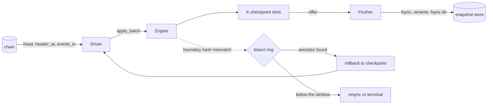

# chainfold

A sans-io fold engine for ordered chain events, with fork recovery and durable snapshots.

<!-- ANCHOR: intro -->
chainfold folds ordered chain events into consumer state: engine-enforced total
order over (block, log_index), fork detection by ancestry commitment, bounded
rollback to retained checkpoints, and a durable snapshot envelope.

### how it works

A relayer or wallet polls logs from one chain and folds them into local state. The chain
reorgs, the node lags, the process restarts. Every consumer rewrites that loop, and the
loop is where the bugs live: skip-and-diverge on a failed event, a cursor that is not
durable, a reorg noticed only when a proof stops verifying.

- **apply**: a poll fills one `Batch`; the `Engine` enforces the total order, drops
  everything at or below the cursor as already applied, and counts the events the fold
  declares are not its own.
- **detect**: each batch carries the current header of the cursor block. A block hash
  commits to its whole ancestry, so a reorg touching anything at or below the cursor
  changes that one hash. One header per poll, one 40-byte compare.
- **recover**: on a mismatch, the driver bisects the ring of observed blocks with
  `header_at` for the deepest still-canonical block, rolls back to the newest checkpoint
  at or below it, and refolds forward. `O(log W)` probes, then deterministic replay.
- **persist**: the driver offers the oldest retained checkpoint to a sink; a flusher
  thread fsyncs it. The durable cursor trails the applied cursor and names what a
  restart recovers, so the apply path never fsyncs and replay closes the gap.



Fold state is fully generic; the crate pins no provider, no runtime, and no storage
engine in its core.
<!-- ANCHOR_END: intro -->

## design

<!-- ANCHOR: design -->
Three layers, each usable without the one above it: the `Engine` (`no_std` + `alloc`,
sans-io, single writer), the `Driver` (sans-runtime, owning cadence, backoff, scanning,
and recovery), and the adapters (`std`: tokio harness, snapshot store, flusher).

- `Position` is `(block, log_index)`. `log_index` is block-unique on EVM, so a tx index
  would be redundant and invite inconsistent adapters.
- dedup is positional only. The cursor is the sole mechanism; there is no seen-set to
  grow without bound.
- `FoldError` is classified at the fold, not guessed by the engine: `Skip` (not mine,
  counted and stepped over), `Halt` (clean below this position, rollback or resync),
  `Poison` (partially mutated, untrusted until a restore).
- `Source` is three reads: `head`, `header_at`, `events_in`. The driver owns the window
  walk, the boundary refetch, and the grouping into spans, so a source cannot get the
  batch shape wrong and every source gets fork detection. The boundary is refetched
  after the events, so a reorg at or below the cursor that lands mid-scan is caught by
  that same poll. Two hashes at one height are a source error. `Ok(None)` from a probe
  means suspected fork.
- rollback is bounded to K retained checkpoints. Over-rollback past still-canonical but
  unobserved blocks is intended; the discarded events replay deterministically.
- the recovery ladder is rollback, then resync from genesis, then a typed terminal state.
  `DivergenceCause` names which rung ran out: fork deeper than the window, no checkpoint
  below the ancestor, source horizon short of the start block.
- `EngineStatus::Unrecoverable` is only left by a `reset`. Automated progress stops
  rather than folding on untrusted state.
- the snapshot envelope is engine-owned: magic, format version, fold identity tag,
  cursor, observed ring, state bytes, CRC32C trailer. The ring travels inside it, so a
  restarted engine detects a reorg that happened while it was down.
- lengths decoded from stored bytes are bounded before any allocation and every offset is
  checked, so a corrupt length prefix is a typed error rather than an OOM primitive.
- the durable cursor rides the manifest as a watermark. Commit writes a temp file, fsyncs
  it, renames, then fsyncs the directory; the manifest is dual-slot, and a commit
  overwrites the older slot so a torn write only damages the copy already superseded.
- the watermark names the snapshot the manifest points at, and counts only offers made
  since the last engine reset. A resync resets the sink, so the watermark drops to none
  at once and rises again only when a snapshot of the new chain commits; a job queued
  before the reset still reaches disk but never raises it. Reporting the old height would
  promise a durable point on a chain that no longer exists. `SnapshotStore::durable_cursor`
  still names what a reopen recovers, which may be the pre-reset snapshot; restarting from
  it is safe, because the ring inside it detects the reorg.
- the observed ring is structure-of-arrays with power-of-two capacity, so bisection binary
  searches the number lane alone and touches one hash at the end. W = 1024 is 40 KiB.
- `Batch` is flat: one contiguous event array plus a span array indexing into it. Two
  allocations per poll, both pooled and reused by the driver.
- the apply path allocates zero. That is a CI assertion under a counting allocator, not a
  convention.
- one engine per chain. Coordinated cross-chain rollback is an explicit non-goal;
  consumers join across chains themselves.
<!-- ANCHOR_END: design -->

## usage

<!-- ANCHOR: usage -->

### fold and engine (`default-features = false`)

```rust,ignore
use chainfold::{Engine, EngineConfig, Fold, FoldError, Position};

#[derive(Clone, Default)]
struct Balances { total: u128 }

impl Fold for Balances {
    type Event = u128;
    type Error = &'static str;

    fn apply(&mut self, _pos: Position, event: &u128) -> Result<(), FoldError<&'static str>> {
        self.total = self.total.checked_add(*event).ok_or(FoldError::Halt("overflow"))?;
        Ok(())
    }
}

let mut engine = Engine::new(Balances::default(), EngineConfig::default())?;

// a batch per poll: ordering, dedup, boundary recheck, fork detection
let summary = engine.apply_batch(&batch)?;
engine.checkpoint();
```

### driver and harness

```rust,ignore
use chainfold::{Driver, DriverConfig, EngineConfig, Tick, harness};

let mut driver = Driver::new(
    Balances::default(),
    source, // your Source
    EngineConfig::default(),
    DriverConfig::from_block(deployment_block),
)?;

// sans-runtime: the whole loop a consumer without tokio writes
loop {
    match driver.tick() {
        Tick::Terminal(_) => break,
        _ => std::thread::sleep(driver.next_delay()),
    }
}

// or, with the tokio feature
let mut handle = harness::spawn(driver);
let status = handle.wait_caught_up().await;
```

A suspected fork bisects to the ancestor and rolls back; only a fork below every retained
checkpoint escalates to a resync. `with_sink` and the `resume*` constructors add a
`SnapshotSink`.

### durability (`storage` feature)

`SnapshotStore::open` returns whatever the last commit made durable, `Engine::decode_snapshot`
rebuilds an engine from it, and `resume` polls onward from the durable cursor. `Flusher` is
the `SnapshotSink` in between: the driver offers, the flusher thread fsyncs, and the
watermark moves onto the committed snapshot only when the fsync returns.

`examples/replay.rs` runs the whole shape end to end: fold to the tip under a live flusher,
survive a reorg, then restart from the durable cursor and converge on the same state.

```sh
cargo run -p chainfold --example replay --features tokio,storage,test-helpers
```

### Features

| feature | pulls in | notes |
|---|---|---|
| (default) | nothing | `no_std` + `alloc` core: engine, driver, traits |
| `std` | crc-fast | runtime-detected SIMD CRC32C, std error plumbing |
| `serde` | serde | derives on `Position` and `BlockRef` |
| `wincode` | wincode, crc | snapshot envelope, `Persist`, `encode_snapshot` / `decode_snapshot` |
| `storage` | `std` + `wincode` | `SnapshotStore`, `Flusher`, `Vfs` |
| `tokio` | tokio | `harness::spawn`, watch-backed status, `wait_caught_up` / `wait_durable` |
| `test-helpers` | nothing | `RecordingFold`, `NoopFold`, `ScriptedChain`, `WatermarkSink`, `CrashVfs` |
| `docs` | include-utils | folds this README into the crate docs |

`default = []`: the core is the part every consumer wants, and the adapters each drag in a
dependency stack that a guest or wasm build has no use for.

### Tuning

- `EngineConfig::ring_capacity` (W): observed-block window, a power of two in `[2, 1 << 20]`.
  It bounds fork detection; a fork deeper than the oldest ring entry is
  `ForkBeyondWindow`.
- `EngineConfig::checkpoint_slots` (K): retained rollback points. Zero disables rollback,
  so `Halt` and `Poison` escalate straight to resync and anchor checks never fire. That is
  the default shape of most consumers today, not an edge case.
- `DriverConfig::checkpoint_interval`: blocks of cursor progress between automatic
  checkpoints. The reorg an offered snapshot survives without a resync is
  `checkpoint_slots * checkpoint_interval` blocks; size both against the deepest reorg
  your chain produces.
- `DriverConfig::snapshot_interval`: blocks of durable-point progress between sink offers.
  `None` disables offers entirely.
- `DriverConfig::poll_interval`, `backoff_base`, `backoff_max`: cadence at the tip, and
  the capped exponential backoff after a source error. A tick that moved the cursor asks
  for no delay, so catch-up and post-resync replay run at source speed.
- `Flusher::spawn(store, queue_depth)`: snapshot jobs admitted before an offer blocks. The
  bound is the backpressure signal when the disk falls behind.
- `StoreConfig::retain`: superseded snapshot files kept beyond the two the manifest names,
  minimum 1.
- `MAX_ENVELOPE_FIELD_LEN` (1 GiB, compile-time): ceiling on a length-bearing envelope
  field. It caps the allocation a decoded length prefix can drive, and encoding past it is
  `SnapshotError::TooLarge`.
<!-- ANCHOR_END: usage -->

## verification

<!-- ANCHOR: verification -->
### verification

[Verus](https://github.com/verus-lang/verus) proves the core invariants in place, in
attribute mode (ethsystems/pm#423). The proofs cover the
`no_std + alloc + wincode` build. Normal builds do not need Verus: every annotation
is behind `cfg(verus_keep_ghost)`. The spec model is in `src/verus/model.rs`. The
trusted items are in `src/verus/tcb.rs`.

#### what Verus proves

Parts marked TODO are in progress (P5 for apply, P8 for the driver).

- **T1, position.** `lt` is a strict total order: irreflexive, transitive, and
  trichotomous. `pos_gt` and `Position::new` match their specs.
- **T2, batch.** `validate` returns `Ok` if and only if the batch is well shaped.
  Well shaped means: blocks strictly ascending, no empty span, and log indices
  strictly ascending in each span. `Ok` implies that the flattened positions are strictly ascending. Each `Err`
  names the first violation (`first_descent` gives the least `i >= 1` with
  `v[i] <= v[i-1]`).
- **T3, apply.** TODO (P5). The parts are: rejection keeps the state, dedup against
  the cursor, total order across calls, idempotence, the post-state, and the fold
  equality.
- **T4, ring and bisection.** Every `BlockRing` fn matches its `Seq` model.
  `index_at_or_below` finds the last entry at or below `n` in at most
  `floor(log2 len) + 1` steps. `canonical_prefix` makes at most `log2 len + 1` source
  calls. Its result is safe under A1 alone. It is optimal under A1, A2′, and
  `down_closed(V)`.
- **T5, checkpoint and rollback.** The checkpoint ring keeps its invariants.
  `rollback_at_or_below` picks the newest live slot at or below the target. It
  restores the fold, cursor, and ring prefix of that slot. An `Err` leaves the engine
  unchanged. The refold invariant `inv(init, log)` holds across `checkpoint`,
  `rollback_at_or_below`, `reset`, and `mark_unrecoverable`. TODO (P5): the same
  invariant across `apply_batch`.
- **T6, durable cursor and restart.** `durable_point() <= cursor()` in every `wf`
  state. `decode_snapshot` returns only `wf` engines, for any input bytes, with no
  trust in the codec or the checksum. `encode_durable_snapshot` returns the durable
  point, and its envelope encodes the durable snapshot. A decoded envelope gives back
  the durable snapshot view, except for the fold (A5). TODO (P8): the driver bound
  `status().durable_cursor <= status().cursor`.
- **T7, driver end to end.** TODO (P8). Take a tick that returns `Progressed` or
  `Idle` with the engine `Active`. After it, the fold equals the fold of the canonical
  log of the view of that tick.

Verus checks every exec fn in the in-scope files for panics and overflow. The only
exceptions are the fns listed as out of scope or pending in `Cargo.toml`.

#### assumptions

- **A1, hash commitment.** A block hash commits to its number, its logs, and its whole
  ancestry. Each view that a source presents satisfies `a1::<S, E>(V)`: `chain(V)`
  plus strictly ascending log indices. The decoded logs are per source type
  (`logs::<S, E>`).
- **A2, scan-view stability.** (i) Each `header_at` and `events_in` call answers from
  one view. The source spec records that view in `sview_log`. (ii) Blocks of earlier
  empty windows are unchanged in the last `events_in` view of the same scan. (iii) No
  ABA: a cursor block that is canonical at the boundary fetch was canonical during the
  last `events_in`.
- **A2′, one bisection view.** All probes of one bisection see one view. Only T4c
  optimality needs it. Optimality also takes `down_closed(V)` as a hypothesis: `V`
  holds every height below each height it holds. `a1` does not include this, because
  a pruned source answers `None` below its horizon. TODO (P8): T7 takes the weaker
  `holds(V, start_block, n)` for each view a tick uses.
- **A3, fold determinism.** `Fold::apply` is a function of the state view, the
  position, and the event. The state view is `fview(&f)`, an uninterpreted `int`
  (`F: ?Sized`, so `Fold` has no `Sized` bound). A `Halt` keeps the view. `Clone`
  keeps the view (tcb item 1). Edits through `fold_mut` must keep the view. For this
  reason `fold_mut` is out of scope.
- **A4, sink honesty.** `SnapshotSink::durable_cursor` is `None` or a point offered
  since the last `reset` (`sink_offered`). The sink given to a driver has offered
  nothing past the engine's cursor and its live slots.
- **A5, state codec.** `Persist::decode_state` of `encode_state`'s bytes gives back
  the same fold view. Safety does not depend on this, only recovery of the same state.
- **A6, trusted items.** Each item in `src/verus/tcb.rs`, listed below.
- **A7, tooling.** Verus, Z3, vstd's `std_specs`, and rustc codegen are correct.
  Allocation succeeds (partial correctness). The `std` build differs from the proved
  build only in import paths and the CRC backend.

#### trusted items (`src/verus/tcb.rs`)

1. `axiom_clone_preserves_fview`: a clone has the same fold view (A3).
2. `PartialOrdSpecImpl for Position`: the derived `PartialOrd` compares block, then
   log index. The test `position_order_is_block_then_log_index` checks it.
3. `OrdSpecImpl for Position`: the same for the derived `Ord`.
4. `Vec::into_boxed_slice` keeps the elements in order (std docs).
5. `<[T]>::sort_by_key` permutes the slice and claims no order, because
   `Batch::validate` checks the order. TODO (P8): `group_into` calls
   `sort_unstable_by_key`, so this entry changes to that fn.
6. `<[T]>::split_last_chunk`: empty contract, it asserts nothing.
7. `snapshot::crc32c`: empty contract. Decode never trusts the checksum value.
8. `wincode::ReadError`: an opaque type, it asserts nothing.
9. `snapshot::read_envelope`: empty contract. Decode checks every decoded field.
10. `snapshot::write_payload`: empty contract. Encode checks the output length itself.
11. `snapshot::trailer_bytes`: empty contract. No proof reads the trailer bytes.
12. `IteratorSpecImpl for Spans`: asserts nothing. `Spans` opts out of the iterator
    laws, so `next` and `size_hint` verify panic-free.
13. `IteratorSpecImpl for Observed`: asserts nothing, as for `Spans`.

`.github/scripts/verus-gates.py` fails when a trusted construct appears outside
`tcb.rs`. It also fails on a fn in an in-scope file that has no verifying attribute
and is not on the out-of-scope list. The list is in `Cargo.toml`.

#### out of scope

- `harness` and `storage/*`: threads and fsync. Fuzz tests cover them, and no proof
  does.
- `Display` and `Debug` impls, and `next_delay` timing.
- Liveness beyond loop termination, and performance beyond the probe bounds.
- Implementations of the trusted traits: `NoSink` (A4) and every `Persist` fold (A5).
- `Engine::fold_mut` (A3).

#### running it

CI runs the `verus` job on x86 Linux with the release pinned in
`.github/workflows/ci.yml`. The job fails unless Verus reports
`N verified, 0 errors` with `N` at or above `VERUS_MIN_VERIFIED`. On x86 Linux:

1. Download the pinned `verus-<version>-x86-linux.zip` and put its directory on `PATH`.
2. Read the toolchain from the zip:
   `jq -r '.verus.toolchain | split(" ")[0]' version.json`.
3. Install it with `rustup toolchain install <toolchain> --component rustc-dev --component llvm-tools`.
4. From the workspace root, run:

```sh
python3 .github/scripts/verus-gates.py --self-test
python3 .github/scripts/verus-gates.py crates/chainfold
RUSTUP_TOOLCHAIN=<toolchain> cargo clean -p chainfold
RUSTUP_TOOLCHAIN=<toolchain> cargo verus verify -p chainfold --features verus,wincode \
    --check-toolchain --fwd-verus-args-to roots
```

Clean before each run. A cached run prints no results line and verifies nothing.
There is no prebuilt Verus for aarch64 Linux. Build it from source there (Verus
`BUILD.md`, Z3 4.16.0), or use CI.
<!-- ANCHOR_END: verification -->

## development

### Prerequisites

- [cargo-hack](https://github.com/taiki-e/cargo-hack?tab=readme-ov-file#installation): to test all combinations of feature flags
- [cargo-nextest](https://nexte.st/): rust test runner

### Check

```sh
cargo hack check -p chainfold --feature-powerset
```

### Clippy

```sh
cargo hack clippy -p chainfold --feature-powerset -- -D warnings
```

### Format

```sh
cargo +nightly fmt -p chainfold
```

### Testing

```sh
cargo hack nextest run -p chainfold --feature-powerset
```

`hack.toml` caps the powerset at depth 2 and groups `serde` with `wincode`; the full
product is mostly redundant given the feature graph.

Three integration tests carry the properties the design is judged on. `restart_identity`
is a proptest for byte-identical restart: an engine that snapshots mid-run and one that
decodes that snapshot encode the same bytes after folding the same blocks, ring wrap
included. `apply_alloc` runs the apply loop under a counting global allocator and asserts
zero allocations, and bounds what a corrupt envelope can allocate on decode.
`storage_crash` fuzzes crash schedules through `CrashVfs` across repeated open-commit
cycles, asserting recovery always lands on a committed prefix.

### Benchmarks

```sh
cargo bench -p chainfold -- --list
```

`chainfold::apply` measures engine overhead through `NoopFold`, so the number is the
bookkeeping alone; `chainfold::snapshot_encode` and `chainfold::snapshot_decode` measure
the envelope codec in bytes per second. `chainfold::recover` times a reorg end to end,
from the boundary mismatch through bisection, rollback, and the refold back to the tip,
at the ring, slot, and interval settings one of our settlement PoCs runs; `chainfold::rollback`
isolates the rollback tick as the fold grows. All are feature-gated; see the
[Cargo.toml entry](Cargo.toml) for the exact flags.
